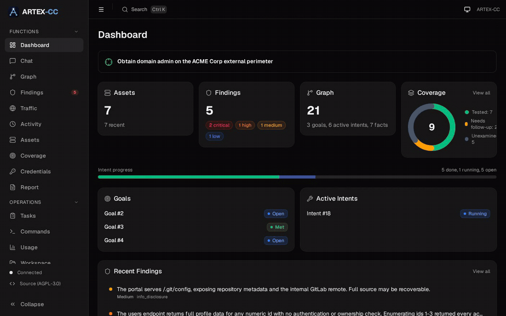
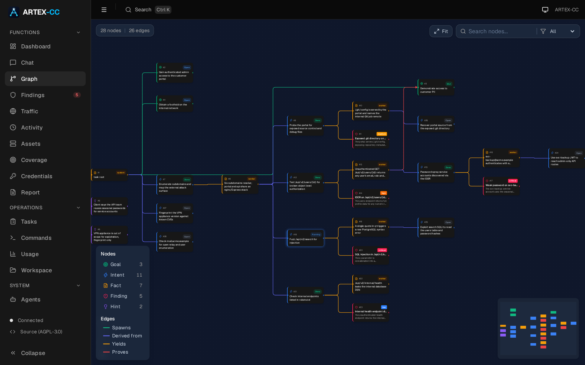
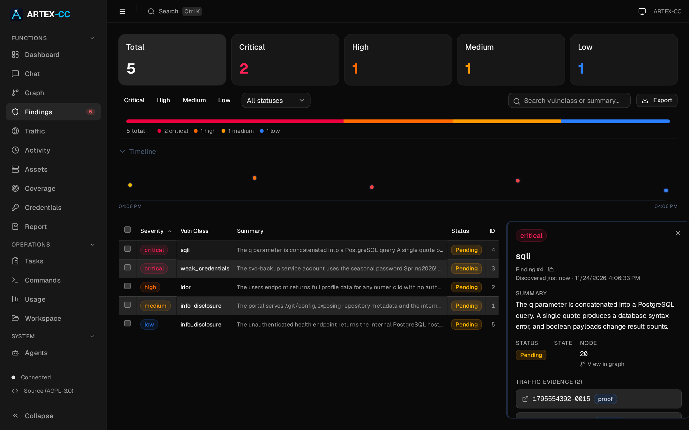
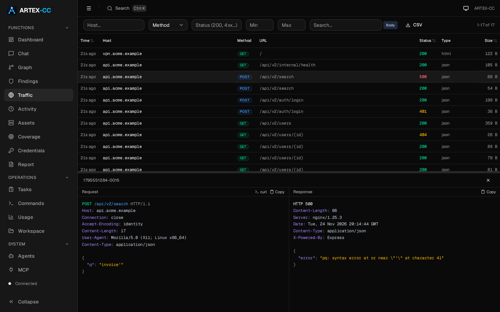

<h1 align="center">
  <picture>
    <source media="(prefers-color-scheme: dark)" srcset="docs/brand/logo-dark.svg">
    
  </picture>
</h1>

<div align="center">

**Use your Claude subscription to run pentests. No API key needed.**

[](https://github.com/SREsAreHumanToo/ARTEX-CC/actions/workflows/ci.yml)
[](https://github.com/SREsAreHumanToo/ARTEX-CC/releases)
[](https://codecov.io/gh/SREsAreHumanToo/ARTEX-CC)
[](https://goreportcard.com/report/github.com/SREsAreHumanToo/ARTEX-CC)
[](https://pkg.go.dev/github.com/SREsAreHumanToo/ARTEX-CC)
[](https://go.dev/dl/)
[](LICENSE)
[](https://github.com/SREsAreHumanToo/ARTEX-CC/stargazers)

</div>

ARTEX is an autonomous penetration testing platform that exposes [upstream ARTEX](https://github.com/BaaRai/ARTEX)'s pentest model as MCP tools Claude Code calls through your existing Claude subscription. Asset graph, exploration tracking, finding management, coverage recording, traffic capture, and report generation, exposed as 62 MCP tools. No separate LLM API key, no token budget, no agent loop of its own.

You bring the brain. ARTEX brings the hands.

<p align="center">
  <strong><a href="https://artex-cc.com">Documentation</a></strong> ·
  <strong><a href="https://artex-cc.com/demo/">Live demo</a></strong> ·
  <strong><a href="https://artex-cc.com/docs/getting-started/">Getting started</a></strong>
</p>

<p align="center">
  
</p>

> **Authorized use only.** This is an offensive security tool, for penetration
> testing, red teaming, CTFs and lab work. Use it only against systems you own
> or have explicit permission to test.

## How it works

<div align="center">
  
</div>

Claude Code decides what to test, what tools to call, and in what order. ARTEX executes the calls: inserting assets, tracking the exploration graph, recording findings and credentials, logging coverage, and capturing HTTP traffic through its built-in recording proxy. The exploration graph keeps Claude oriented across long engagements, so a session you stop today resumes tomorrow with `graph_overview`.

```
$ claude
> Pentest example.com, starting with reconnaissance.

Claude calls: graph_overview → set_goals → insert_assets (domain: example.com)
         → add_intent (enumerate subdomains) → record_fact (found: api.example.com)
         → insert_assets (subdomain: api.example.com, service: https/443)
         → add_intent (test api.example.com for auth bypass)
         → traffic_hosts → traffic_search (host: api.example.com)
         → traffic_get (inspect the auth request)
         → traffic_replay (replay with modified auth header)
         → record_coverage (api /admin, idor, no_issue_found)
         → report_finding (severity: high, broken access control on /api/v2/users)
         → prove_goal (evidence: finding #1) → generate_report
```

### Eval: HTB Forest (blind, no writeups)

ARTEX + Claude Opus 5.5 against [Forest](https://app.hackthebox.com/machines/Forest), a classic Active Directory box, with no web searches, writeups or hints. AS-REP roast to a foothold, then Exchange Windows Permissions to DCSync and Domain Admin. Both flags in ~8 minutes, with cleanup afterwards. Full walkthrough: [artex-cc.com/evals/htb-forest](https://artex-cc.com/evals/htb-forest/).

## Web UI

`artex-cc serve --web` adds a dashboard on the same port as the MCP endpoint: the exploration graph, findings with their bound traffic, coverage, credentials, and a printable report, updated live. See [Web UI](https://artex-cc.com/docs/web-ui/).

| Exploration graph | Findings |
| :---: | :---: |
|  |  |

| Traffic (recording proxy) | Coverage matrix |
| :---: | :---: |
|  |  |

<sub>Screenshots use a seeded demo engagement against reserved `*.example` names and documentation IP ranges.</sub>

## Install

```sh
brew install SREsAreHumanToo/tap/artex
```

Docker Compose, pre-built binaries and `go install` are covered in [Getting started](https://artex-cc.com/docs/getting-started/).

## Quick start

With PostgreSQL running:

```sh
createdb ccartex
artex-cc init --pg "postgres://localhost/ccartex" --goal "Pentest example.com"
```

Add the server to Claude Code (`~/.claude.json` or a project `.mcp.json`):

```json
{
  "mcpServers": {
    "artex": {
      "command": "artex-cc",
      "args": ["serve", "--stdio", "--pg", "postgres://localhost/ccartex", "--proxy", ":8788"]
    }
  }
}
```

Start Claude Code and ask it to "pentest example.com, starting with reconnaissance". For Docker, other MCP clients and proxy CA trust, see [Getting started](https://artex-cc.com/docs/getting-started/).

## Documentation

Full documentation lives at **[artex-cc.com](https://artex-cc.com)**:

- [Getting started](https://artex-cc.com/docs/getting-started/): install, first engagement, Docker
- [MCP clients](https://artex-cc.com/docs/mcp-clients/): Claude Code, Cursor, Cline, Windsurf, Zed and others
- [Configuration](https://artex-cc.com/docs/configuration/): commands, flags, environment variables, credential encryption, proxy CA
- [Web UI](https://artex-cc.com/docs/web-ui/): dashboard, auth, chat
- [Hands-free mode](https://artex-cc.com/docs/hands-free/): let Claude run the engagement on a loop
- [Example walkthrough](https://artex-cc.com/docs/walkthrough/): a full engagement, phase by phase
- [Tool reference](https://artex-cc.com/docs/tools/): every tool and its parameters
- [Architecture](https://artex-cc.com/docs/architecture/): the exploration graph, codebase layout, comparisons
- [Troubleshooting](https://artex-cc.com/docs/troubleshooting/)
- [Evals](https://artex-cc.com/evals/), [changelog](https://artex-cc.com/changelog/) and [roadmap](https://artex-cc.com/roadmap/)

## Contributing and support

- [CONTRIBUTING.md](CONTRIBUTING.md) for build instructions and how to add a tool
- [GitHub Issues](https://github.com/SREsAreHumanToo/ARTEX-CC/issues) for bugs and feature requests
- [GitHub Discussions](https://github.com/SREsAreHumanToo/ARTEX-CC/discussions) for questions and ideas
- [SECURITY.md](SECURITY.md) for reporting vulnerabilities

## License

ARTEX-CC is licensed under the [GNU Affero General Public License v3.0](LICENSE) (AGPL-3.0-only).

Parts of it, including the traffic proxy, egress governor, report generation and database schema, are derived from [ARTEX](https://github.com/BaaRai/ARTEX) by Autumn-27, BaaRai and the ARTEX contributors, which is also AGPL-3.0. [NOTICE](NOTICE) lists the derived files and third-party notices.

If you run a modified version as a network service, AGPL section 13 requires you to offer its users the corresponding source. The web UI links to the source for this reason.

Releases v0.1.0 through v0.3.0 were published with an MIT license file in error. They contain the same ARTEX-derived code and are distributed under AGPL-3.0 as well.
